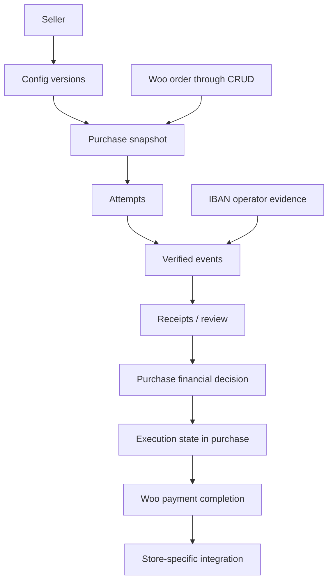

# Фінансова модель v1

Контракт для реалізації FR05–17 [PRD v3.2](sources/PRD-v3.2.md). Реалізація етапів 3–7 покриває seller routing, purchase/payment storage, два payment channels та базове виконання; інтеграційне приймання й міграція історичних замовлень лишаються окремою роботою.

## Межі та джерела істини

WooCommerce відповідає за каталог, розрахунок ціни/податків/доставки, замовлення та залишки. Форк відповідає за продавця, незмінні фінансові умови, спроби, надходження, рішення й запуск штатного виконання. LMS/CRM не є частиною транзакції БД форка.

- Seller — стабільна юридична особа/ФОП, не номер профілю у списку.
- Config version — реквізити того самого отримувача; новий merchant/IBAN створює нову версію.
- Purchase — одна зафіксована покупка Woo з одним продавцем. Це агрегат координації, не нове Woo-замовлення.
- Attempt — виданий спосіб спробувати оплату. Не доказ грошей.
- Receipt — доказ надходження з фактичними сумою, валютою й отримувачем. Не доказ виконання.
- Event — незмінний запис фінансового повідомлення чи рішення оператора.
- Execution — стан виклику Woo для прийнятої покупки. Зберігається у purchase; окрема універсальна черга не потрібна.

## Зберігання

Шість таблиць з `$wpdb->prefix . 'wfpms_'`, InnoDB, versioned migrations. Немає SQL-записів у таблиці Woo orders/posts. Зв'язки з Woo перевіряє application layer; каскадне видалення грошей при видаленні замовлення заборонене. DDL і типи JSON у PHP реалізації уточнюються під мінімальні версії, але ключі нижче обов'язкові.

| Таблиця | Мінімальні поля | Ключі / інваріанти |
|---|---|---|
| `sellers` | id, internal_label, legal_name, tax_id, active, current_config_id, used_at, row_version | PK id; legal identity незмінна після першого оформлення; не вимагати глобально унікальної display name |
| `configs` | id, seller_id, version, recipient_name, tax_id, iban, bank, purpose_template, merchant_account, domain, card_enabled, iban_enabled, credential_ref, checked_by, checked_at | UNIQUE(seller_id, version); append-only після використання; видалення використаних версій заборонене |
| `purchases` | id, order_id, seller_id, config_id, financial_snapshot, snapshot_hash, row_version, finalized_at, locked_at, expires_at, state, accepted_receipt_id, free_basis, execution_state, execution_token, execution_started_at, execution_updated_at, execution_error_code | UNIQUE(order_id); один прийнятий receipt або free_basis; збережене виконання створюється разом з фінансовим рішенням |
| `attempts` | id, purchase_id, channel, merchant_account, external_reference, config_id, signing_key_version, expected_amount, currency, scale, snapshot_hash, issued_at, expires_at, status | UNIQUE(external_reference); криптографічно випадковий reference, не ID+секунда; жодних секретів |
| `receipts` | id, purchase_id, attempt_id nullable, source, source_scope, external_id, provider_reference, amount, scale, currency, actual_recipient, occurred_at nullable, time_evidence, recorded_at, classification, first_event_id | UNIQUE(source, source_scope, external_id); immutable фактичні поля, classification — projection журналу |
| `events` | id, purchase_id, attempt_id nullable, receipt_id nullable, dedupe_key, kind, received_at, actor_id nullable, reason, sanitized_evidence, related_event_id nullable | UNIQUE(dedupe_key); append-only; refund/correction/decision не стирають попередню подію |

Реквізити категорій — term meta; manual seller товару — product meta. Секретів там немає. В order meta через CRUD зберігаються purchase ID і знімок для відображення/експорту; фінансове рішення читається з committed purchase/receipts, а не з потенційно відсталого meta.

Розбіжність проєкції Woo й фінансового журналу створює review, не переписує гроші. Відсутнє/видалене Woo-замовлення не заважає зберегти відомий валідний callback; виконання блокується до перевірки.

### Гроші та ключі

- Суми — точні десяткові рядки у `DECIMAL(20,6)` з зафіксованим scale; binary float не є джерелом порівнянь. Непідтримуваний scale/діапазон відхиляється до форми.
- Woo розраховує total; payload formatter відповідає за точну серіалізацію підпису. Вхідне значення спочатку структурно перевіряється й автентифікується за контрактом провайдера, потім нормалізується для порівняння. Зміна глобальної кількості десяткових знаків не змінює старий purchase.
- Card receipt `provider_reference` зберігає `orderReference`; `external_id` — локальний SHA-256 ID для підписаного callback evidence. Ідентичний повтор callback є ідемпотентним; відмінне підписане `Approved` з тим самим reference зберігається окремим receipt у review і не змінює вже прийнятий receipt чи повторно запускає виконання. Це не provider transaction ID: якщо два списання мають ідентичні підписані поля, їх неможливо розрізнити за задокументованою схемою. Не трактувати authCode чи PAN як гарантований transaction ID.
- IBAN identity: `(iban, canonical_recipient_account, bank_operation_id)`, через усі замовлення й версії профілю. IBAN нормалізується до uppercase без пробілів. Bank operation ID лишається opaque, без обрізання або довільної зміни регістру.
- Для довгих складених ключів — SHA-256 канонічного length-prefixed представлення плюс збережені вихідні несекретні поля; конфлікт хешу звіряється по полях, а не означає мовчазний duplicate.
- Event dedupe для картки включає перевірені підписані поля/тип події. Непідписані timestamp/email не створюють новий фінансовий факт. PAN потрібний лише під час перевірки; сирий payload, recToken, ключі й PAN не зберігаються у журналі.
- Operator command має окремий idempotency key. Повтор з тим самим ключем і зміненим змістом — conflict, не нова дія.

## Життєвий цикл purchase

Draft можна зберігати без purchase. Finalize перевіряє всі товари й налаштування, фіксує продавця/config; seller used_at і purchase створюються узгоджено. До першої спроби фінансові умови можна оновити після повторної валідації, але не продавця вже оформленої покупки.

Перша видача форми/інструкцій фіксує snapshot_hash, locked_at, expires_at і attempt до відповіді клієнту. Зміна товарів, кількостей, ціни, total, currency, знижок, податків, доставки чи зборів після lock заборонена. Контакти й примітки не входять у фінансовий hash; зміна адреси не обходить правило перерахунку.

Повторна оплата використовує той самий purchase/config. Новий attempt має новий reference. Просте оновлення сторінки існуючої спроби не створює новий attempt. Зміна card↔IBAN не змінює первинного expires_at. Для зміни покупки створюється нове пов'язане Woo-замовлення.

Для zero purchase безпосередньо фіксуються free_basis і execution pending, без attempts/receipts. Усі товарні та seller policies діють; недоступний платіжний шлюз не перешкоджає дозволеному zero.

## Транзакції та координація

Єдиний ключ блокування: поточний site + Woo order ID. Для підтримуваних deployment v1 — один primary DB, одна request connection. Модель: request-scoped MySQL advisory lock як у наявному проєкті плюс короткі InnoDB-транзакції та `SELECT FOR UPDATE` purchase. Блокування не замінює UNIQUE constraints. Проксі, які змінюють connection усередині request, потребують окремої перевірки сумісності.

Порядок блокувань: seller/config (лише finalize або зміна профілю) → order advisory lock → purchase row → attempts/receipts/events. Callback та completion не блокують seller row. Кожна операція має bounded timeout; на lock/DB failure платіжна форма не видається, а callback отримує retryable failure.

1. Finalize і financial edit координуються з усіма підтримуваними CRUD/API hooks. Для order items потрібні guard-и їх власних save/delete шляхів, одного order-save hook недостатньо.
2. Begin payment повторно читає свіжий Woo order під order lock, перевіряє revision/hash, потім фіксує lock+attempt в транзакції. Лише після commit повертає форму. На crash до відповіді attempt можна відобразити повторно без зміни умов.
3. Callback: обмежити body, знайти attempt, завантажити тільки довірений merchant keyring, перевірити підпис; повторно прочитати attempt під lock. Однією транзакцією зберегти event, receipt/exception, рішення purchase і pending execution. Commit перед ACK.
4. IBAN confirmation використовує той самий order lock і UNIQUE account+operation. Дві різні покупки, що одночасно претендують на один bank ID, узгоджує UNIQUE constraint; переможець один, інший отримує existing/conflict.
5. Deadline worker бере той самий lock; accepted/free purchases не скасовує. Спершу durable expiry intent, потім штатний Woo cancellation. Якщо cancellation перервався, нові платежі вже заблоковані, незавершена дія видима.
6. Execution отримує CAS claim pending→running і token. Виклик Woo відбувається поза SQL-транзакцією, під order advisory lock; перед ним повторно перевіряються refund/cancel guards. Сторонній I/O не є частиною atomic commit. Lock timeout інших callback не втрачає подію — ACK не видається, потрібна повторна доставка.
7. Crash звільняє DB connection lock; running лишається durable. Watchdog позначає review, але не запускає повторний payment_complete без перевірки ефектів. Застарілий worker не фіналізує job без актуального token.

Не обіцяти транзакцію між Woo hooks та зовнішньою LMS. Навіть правильний DB lock не робить лист чи віддалений HTTP-виклик exactly-once.

## Контракт callback та часу

Підпис перевіряється до довіри до amount/currency/merchant. Неправильний підпис не створює receipt; зберігається лише обмежена технічна діагностика. Відомий підписаний success з mismatch створює durable exception за №65. Незнайомий merchant не додається до keyring на підставі вхідного payload.

ACK означає durable приймання фінансового повідомлення, а не успіх LMS. Валідні duplicate, review та refund events ACK-аються після commit; storage failure — без success ACK. Unknown reference не отримує автоматичного зв'язку з новим замовленням через парсинг ID; legacy adapter має окремий verified mapping.

Підпис Purchase не захищає processingDate. Received-at до дедлайну засвідчує, що verified повідомлення вже існувало до дедлайну; після дедлайну непідписаний provider time не дозволяє автоматичне виконання. Operator-verified bank date або окрема достовірна звірка може уточнити час, але скасована/звільнена покупка все одно потребує ручного рішення. Reconciliation API не обов'язковий для v1.

## Виконання й ручний розгляд

Після accepted receipt нові спроби не видаються, навіть якщо Woo status/meta відстає. Видимий стан «оплату отримано, виконання перевіряється». Самі mismatch/partial receipts не означають повного погашення purchase; оператор бачить фактичні суми до рішення.

Оператор із фінансовим правом може зафіксувати: accepted for execution, needs further evidence, refund recorded або rejected allocation. Дія зберігає actor, reason, receipt/event IDs і попередній state; під тією самою order lock. Не можна змінити отримувача чи перетворити платіж іншій особі на оплату потрібному продавцю. v1 не агрегує часткові надходження автоматично; складні розбіжності вирішуються вручну з явною підставою, без зміни первинних сум.

Пізню точну оплату можна прийняти лише після перевірки актуальності покупки/залишків. Якщо прийнятий receipt уже є, повторне прийняття іншого не запускає execution. Виконана покупка ніколи не стає pending від другого надходження.

Refund — окремий event конкретного receipt з повернутою сумою, валютою, доказом, автором/джерелом і локальним idempotency key. Refund та correction не переписують gross amount. Невідома семантика provider refund — review P03. Поточна версія форку не має автоматизованого refund API або операторської форми для запису такого event: повернення виконується поза форком у WayForPay M-portal, а внутрішній доказовий журнал до реалізації цієї форми ведеться за зовнішньою процедурою. Не повторювати запит після невизначеного timeout; спершу звірити стан у кабінеті/транзакціях. Не прирівнювати повернення зайвого receipt до скасування прийнятої покупки. Partial refund і зовнішній revoke виконуються лише за перевіреним адаптером/операторським рішенням.

## Секрети та доступ

Merchant secrets зберігати лише як authenticated ciphertext з key ID; master key — поза БД у deployment secret. Етап 3 реалізує це в seller-config таблиці через AES-256-GCM/OpenSSL, а цільова модель `credential_ref` залишає відкритим винесення сховища в окремий backend. До етапу 5 потрібно узгодити межу сховища та процедуру key rotation. Не використовувати WordPress salts. Без доступного ключа карткова конфігурація не може видати платіж; відновлення backup має включати захищений master key. Реальні secrets не включалися до репозиторію.

Ротація секрету того самого merchant створює нову append-only config версію; purchase/attempt зберігає посилання на версію, з якою була створена оплата, а callback перевіряється її зашифрованим ключем. Це локальний механізм збереження ключа, не гарантія WayForPay щодо старого ключа після ротації. До підтвердження provider overlap/rotation semantics незавершені оплати не вважати безпечно перенесеними на новий ключ. Старий merchant не замінюється новим. Експорт конфігурації не містить ключів/ciphertext.

Права: адміністратор конфігурації; окреме право confirm_bank_receipt/review_payment; покупець лише власне замовлення або штатний guest order-key access. Усі адміністративні mutations — capability+nonce, не GET. REST не приймає trusted seller/snapshot від клієнта. Нові ролі не призначаються людям автоматично.

Міграції schema version зберігають дані й не видаляють фінансові факти при uninstall/deactivate. Retention та purge потребують окремого deployment policy; збереження надходжень не означає безстрокове збереження всіх PII. Raw callbacks не зберігати.
