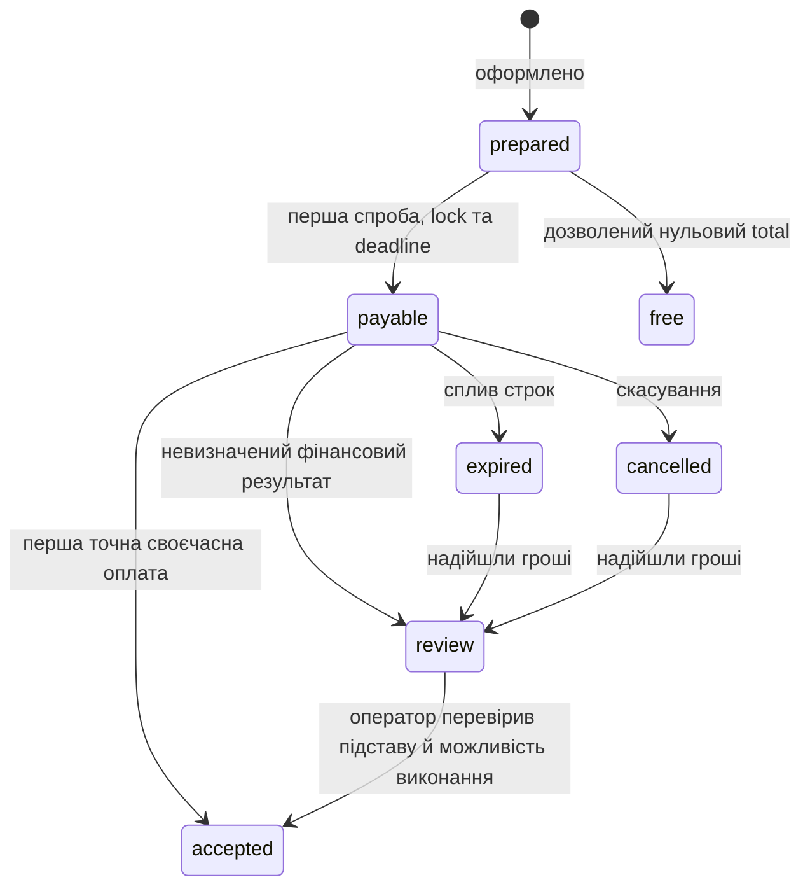

# Стани та результати операцій

Нормативна модель реалізації [financial-model](financial-model.md); поведінка задана FR05–17 PRD.

## Незалежні стани

Окремо від життєвого циклу окремого замовлення магазин має стан продажів `active/paused`. Пауза блокує новий checkout і створення purchase, але не скасовує callback-и, повторну оплату вже зафіксованого purchase, звірку надходжень чи виконання.

| Об'єкт | Стани | Що не означає |
|---|---|---|
| Purchase | prepared, payable, accepted, free, expired, cancelled, review | Accepted не доводить завершення LMS |
| Attempt | issued, declined, expired, succeeded, review | Declined однієї спроби не скасовує успішну іншу |
| Receipt classification | accepted, duplicate-payment, mismatch, late, review | Mismatch не стає оплаченим замовленням |
| Execution | none, pending, running, done, review | Done означає результат власного Woo-процесу, не всіх сторонніх ефектів |
| Refund | Незмінні події з projection returned total/review | Refund зайвого receipt не забирає доступ до прийнятої покупки |

Повернення записується як окрема подія до конкретного receipt після перевірки в зовнішньому кабінеті. Форк не відправляє гроші; повтор того самого refund ID не створює нової події, а накопичена сума не може перевищувати gross конкретного receipt.

Після cutover callback зі збереженим migration mapping перевіряє фінансове ядро форку. Callback без mapping передається далі оригінальному WayForPay gateway, який має залишатися встановленим і активним для завершення обробки його старих замовлень. Міграційна перевірка блокує cutover, поки лишаються відкриті неоплачені legacy-замовлення.

Скасування після accepted не стирає accepted_receipt_id і не робить можливим новий платіж. Повернення/доставка мають власні рішення; purchase state не замінює Woo order status.

Технічний retry не є операторським прийняттям. Accepted/free не переходять у payable. Перед поверненням до виконання після review перевіряються refund guards, існуючий accepted_receipt та попередні ефекти.

## Таблиця рішень

| Подія | Фінансове збереження | Виконання / відповідь |
|---|---|---|
| Неповний draft | Не створювати purchase/attempt | Зберегти draft; форму/IBAN не видавати |
| Видача форми | Snapshot+attempt+deadline commit | Повернути форму лише після commit |
| Перша точна Approved активної покупки | Event+receipt+accepted decision+pending execution атомарно | ACK після commit, один claim execution |
| Повтор того самого Approved | Existing event/receipt | ACK; не повторювати execution |
| Інший reference Approved | Окремий receipt | Duplicate-payment review, не друге виконання |
| Card та IBAN одночасно | Два receipts | Один accepted pointer і одна execution |
| Валідний підпис, відома спроба, неправильна сума/валюта/очікувані реквізити | Durable mismatch exception; якщо ідентичність receipt невизначена — event+review | Не приймати оплату замовлення; ACK durable event |
| Неправильний/відсутній підпис | Не створювати receipt | Відхилити, без success ACK |
| Валідний callback, відоме attempt, Woo order відсутній | Зберегти фінансовий факт, review | Не губити гроші й не створювати нове замовлення автоматично |
| Success після deadline/cancel/revoke | Receipt+review | ACK; без автоматичного відновлення |
| Стара Declined після Approved | Зберегти event, accepted не змінювати | ACK; Woo не переводити у failed |
| Refunded до запізнілого Approved | Durable refund guard і evidence | Approved не відкриває доступ; звірка receipt/refund |
| IBAN точно на рахунок, своєчасно | Receipt з bank ID і actor | Спільний фінансовий decision |
| Повтор IBAN на іншому order | UNIQUE конфлікт, посилання на існуючий receipt | Не зарахувати двічі |
| Partial/excess/foreign currency/wrong recipient | Фактичний receipt/event+review | Без автоматичного сумування чи виконання |
| Zero | Free basis+pending execution атомарно | Без gateway, attempt або receipt |
| Deadline одночасно з оплатою | Під спільним lock перемагає узгоджене рішення | Accepted не скасувати; після expiry гроші зберегти в review |
| Архівування seller | Історія й keyring збережені | Нові покупки заборонені; старі callbacks приймаються; нові спроби старих покупок за FR10 |
| Зміна реквізитів | Нова config | Старі purchase лишаються на старій config |
| Ручна зміна Woo status | Не створює receipt/free basis | Не видавати нову фінансову підставу |

## Межі crash recovery

| Точка збою | Що переживає збій | Відновлення |
|---|---|---|
| До commit першої спроби | Немає виданої форми | Повторити prepare після валідації |
| Commit attempt, до відповіді браузеру | Збережений attempt | Повторно відобразити той самий attempt |
| До commit callback | Немає ACK | Провайдер повторить; не вважати RAM-запис оплатою |
| Commit receipt/decision, до ACK | Гроші та pending execution | Duplicate callback ACK, pending видно сканеру |
| ACK, до execution claim | Pending у БД | Runner може взяти ще не розпочату дію |
| Running до/всередині Woo hooks | Receipt, token, початок execution | Review/readback; не сліпий повтор |
| Woo змінив стан, результат не записано | Невизначений running | Звірити effects; native paid сам по собі не доводить LMS |
| Watchdog позначив review, worker повернувся | Event history, current token | Stale token не завершує job; ефекти перевіряє оператор |
| Після expiry intent, до Woo cancel | Durable заборона нових спроб | Звірити stock/status, завершити cancellation без подвійного restock |

## Контракт майбутніх перевірок

Це перелік сценаріїв, не додані/запущені тести.

- FR13, №42–43, 49, 64: одночасні callbacks для одного order та одночасний bank ID для двох orders; один accepted, усі справжні гроші збережені.
- FR14, №46, 60: edit і begin-payment одночасно; жодна форма не використовує суміш старих та нових умов.
- FR15, №44–45, 62: crash у кожній точці таблиці вище; ACK не залежить від LMS; running не перезапускається сліпо.
- FR16, №52–53, 57: zero без gateway, дубль finalize, збій виконання; жодного вигаданого receipt.
- FR17, №54–55, 59: успіх проти deadline, непідписаний processingDate, звільнений stock, перегляд та перемикання способу не подовжують строк.
- FR13, №56, 65: refund зайвого receipt не скасовує прийняту покупку; signed mismatch лишається видимим, його повтор не дублюється.
- FR05/10/12, №21–22, 35, 41, 48, 51, 61, 63: draft, immutable seller/config, historical callback ownership, key rotation з умовами P02.

## Приймання моделі

Усі переходи визначають фінансовий факт окремо від побічних ефектів. Невизначеність провайдера не маскується: P01–P03 з audit-and-reuse залишаються release gates відповідних функцій. Немає автоматичного перенесення між merchant, автоматичного refund переплати або універсального replay LMS.
